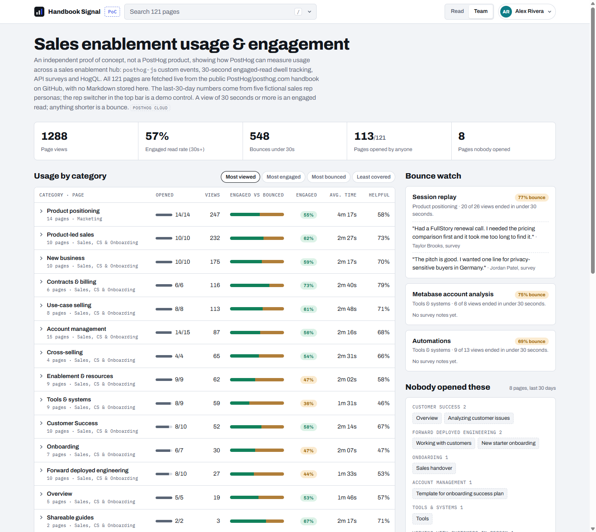
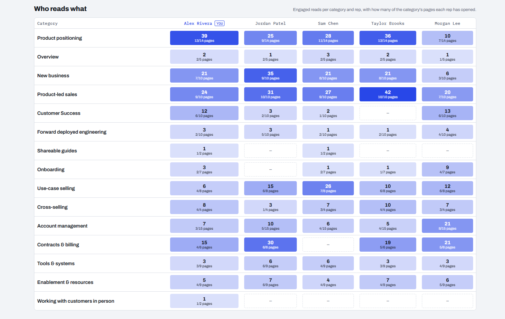
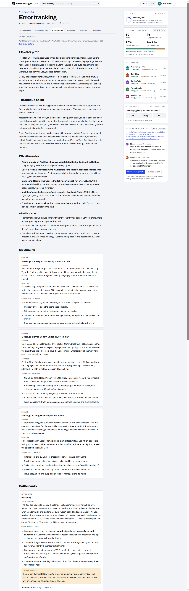
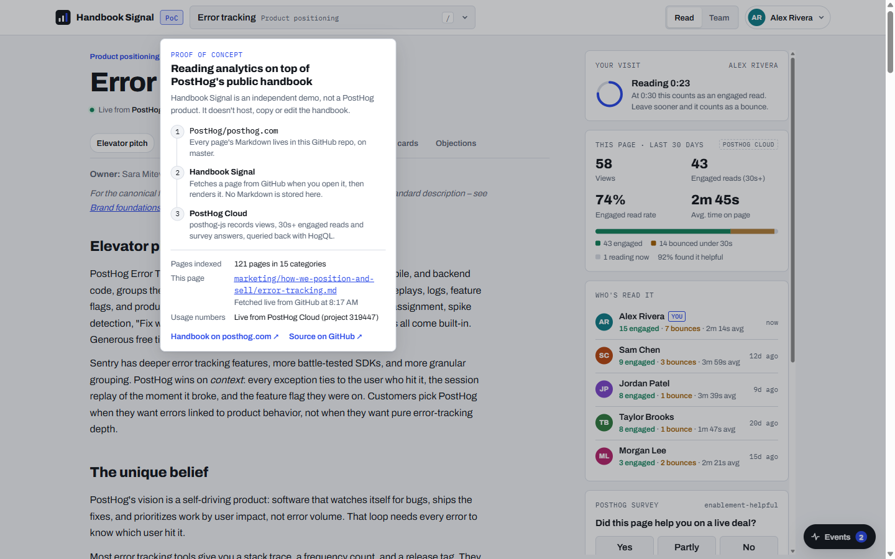
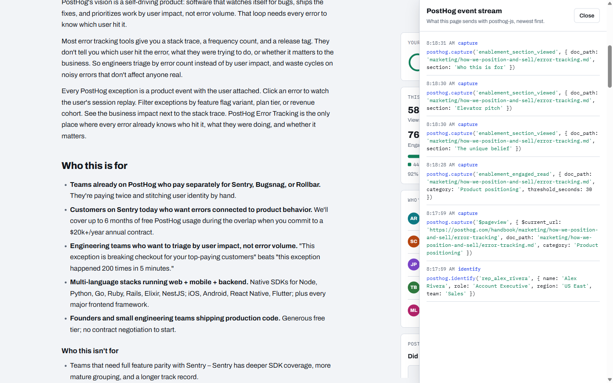

# Sales Enablement Signal

## Why I built this

Anyone running a sales enablement program wants to know which resources (battlecards, launch briefs, messaging, docs, playbooks, etc.) reps actually rely on, which ones they bounce from quickly, where the coverage gaps are, and what moves the needle on a deal.

After using PostHog for product analytics in [my own app](https://marcora.ai), I realized **PostHog could easily be used to power usage and engagement tracking within a sales enablement hub.**

I built this proof of concept over a weekend with Claude Code to demonstrate integrating PostHog for the analytics and feedback layer: `posthog-js` custom events, person profiles, an API survey and HogQL queries.

Every number comes live from PostHog, including 30 days of sample history I generated and loaded in so there's something to look at.

PostHog publishes its real sales, CS and positioning handbook openly at [`PostHog/posthog.com`](https://github.com/PostHog/posthog.com), so this proof of concept uses those 121 real pages as its content instead of placeholder docs. It does not host, copy or edit them: every page is fetched live from GitHub when a rep opens it, and no handbook Markdown is stored in this repository.

> **This is a proof of concept, not a PostHog product.** It is an independent demo and is not affiliated with or endorsed by PostHog. The five sales reps in it are fictional personas, and the 30 days of history it ships with is generated sample data (see [Seeding](docs/ARCHITECTURE.md#seeding-a-fresh-project)).
>
> The rep switcher in the top bar is a **demo control**: it lets you switch between the five fictional reps in one browser and exercise the `posthog.reset()` and `posthog.identify()` flow for each. There is no login. A real deployment would require authentication (SSO) and identify the signed-in rep automatically, rather than running as an anonymous app with a user switcher.



*The Team view, where the app opens: usage by category, Bounce watch with the survey notes reps left, and the pages nobody opened in 30 days. The top bar shows `Search 121 pages` until a page is opened.*

## If I built this for real

This is a proof of concept. A real version would add:

- Agent reads. Reps increasingly pull enablement through AI agents instead of opening pages, and page tracking can't see that. I'd serve the content over MCP and measure those reads with PostHog's MCP Analytics. PostHog's own handbook page [Turning knowledge into agent skills](https://posthog.com/handbook/growth/sales/turning-knowledge-into-agent-skills) shows where this is heading.
- A login, so who-read-what comes from real identities instead of a rep picker.
- CRM data, so a read can be tied to the open opportunity it was likely for.
- Suggestions before calls. When a rep opens it, it would recommend what to read based on their upcoming meetings.
- Closing the loop. The pages reps bounce from, plus their notes on what was missing, are exactly what you'd hand an AI to draft a fix to that page for a person to review and merge.

## Contents

- [Why I built this](#why-i-built-this)
- [If I built this for real](#if-i-built-this-for-real)
- [What it shows](#what-it-shows)
- [PostHog features used](#posthog-features-used)
- [How it's implemented](#how-its-implemented)
- [Quick start](#quick-start)
- [Repository structure](#repository-structure)
- [Limits of the PoC](#limits-of-the-poc)

## What it shows

### 1. A Team view for enablement teams

The **Team** tab is the part a program owner would open on Monday morning. It turns the raw events into a decision surface:

- **Usage by category**: 15 categories, expandable to pages, ranked by most viewed, most engaged, most bounced or least covered.
- **Bounce watch**: pages most people leave in under 30 seconds, with the survey notes reps left about them.
- **Nobody opened these**: pages with zero views in 30 days.
- **Who reads what**: engaged reads per category and rep, as a heatmap.



> The numbers in these screenshots are the seeded sample history plus a handful of real sessions on the demo instance, so they will not match a fresh install exactly.

### 2. A reading view that tells you how the page is doing

Open any of the 121 pages (14 product-positioning pages from the marketing handbook, plus the Sales, CS and Onboarding section, grouped into 15 categories the way the handbook's sidebar groups them) and you get the handbook's own Markdown, rendered live, next to:

- **Your visit**: a dwell timer that turns a view into an *engaged read* at 30 seconds, or a *bounce* if the rep leaves sooner.
- **This page, last 30 days**: views, engaged reads, engaged-read rate, average time on page and a bounce split, all queried from PostHog Cloud.
- **Who read it**: per-rep engaged reads, bounces and how long ago each rep last opened the page.
- **A one-question survey**: *"Did this page help you on a live deal?"* with Yes / Partly / No and an optional *"What was missing for your deal?"* note.



*The Reading view for `Error tracking`, captured as one tall screenshot: the `PoC` tag and the live provenance line at the top, the handbook's messaging and the `vs Sentry` battle card below, and the right-hand rail of live PostHog data for this page (views, engaged reads, who read it, the survey and the GitHub discussion).*

### 3. Provenance, said once and kept out of the way

The handbook is the source of truth, so the app is honest about that without pushing the content down the page:

- A compact **`PoC`** tag in the top bar opens an About popover with the three-step data flow, the page count, the fetch state of the current page and the PostHog Cloud project it reads from.
- A single line under every title shows **`● Live from PostHog/posthog.com`** with direct links to the canonical `posthog.com/handbook/...` page and to the `.md` source on GitHub.



### 4. A live view of exactly what is sent to PostHog

The **Events** button opens a drawer that lists every `posthog.identify` and `posthog.capture` call the page makes in the current session, newest first, with the real property payloads. It makes the instrumentation easy to audit and easy to copy.



## PostHog features used

| PostHog capability | How Sales Enablement Signal uses it |
| --- | --- |
| **Product analytics: custom events** (`posthog-js`) | Five events describe a reading session: `$pageview`, `enablement_section_viewed`, `enablement_engaged_read`, `enablement_page_left` and `survey sent`. See the schema below. |
| **Engagement as a derived metric** | An engaged read is 30 seconds of *visible-tab* dwell in the Read view. The timer pauses when the tab is hidden and when the Team view is open. For a battlecard, time spent reading is a better signal than a "copy" button. |
| **Person identification** (`posthog.identify`, `posthog.reset`) | Each rep is a PostHog person (`rep_alex_rivera`, and so on) with `name`, `role`, `region` and `team` properties. Switching reps calls `reset()` then `identify()`, so each person's events never bleed into another's. |
| **Surveys** (`enablement-helpful`) | A PostHog survey of type `api` with a single-choice question and an optional open question, created by the setup script. The app renders its own in-context UI and sends answers as PostHog's standard `survey sent` event with the survey's UUID as `$survey_id` (PostHog links responses to a survey by UUID, not name), plus `$survey_response` and `$survey_response_1`, so responses show up in PostHog's Surveys UI like any other. |
| **HogQL and the Query API** (`POST /api/projects/:id/query/`) | The server runs two HogQL queries over the last 30 days (usage and survey answers) and returns the rolled-up result to the UI. Viewers get the numbers without needing a PostHog login. |
| **Ingestion API** (`/batch/`) | The seeding script backfills 30 days of history in batches, with deterministic event UUIDs so a re-run cannot double-count. |

### Event schema

| Event | Fired when | Key properties |
| --- | --- | --- |
| `$pageview` | A page is opened in the Read view, and when the Team tab opens | `$current_url` (`https://posthog.com/handbook/...` for pages, `/team-usage` for Team), `doc_path`, `category` |
| `enablement_section_viewed` | A rep scrolls a section (Elevator pitch, Battle cards, Objections, ...) into view after more than 2 seconds on the page. Fires once per section per visit, from an `IntersectionObserver`. | `doc_path`, `section` |
| `enablement_engaged_read` | Visible dwell reaches 30 seconds. Fires at most once per visit. | `doc_path`, `category`, `threshold_seconds: 30` |
| `enablement_page_left` | The rep leaves the page, switches page or rep, opens Team, or closes the tab | `doc_path`, `dwell_seconds`, `engaged_read` |
| `survey sent` | The rep answers the survey | `$survey_id` (the survey's UUID), `$survey_name: "enablement-helpful"`, `$survey_response` (`Yes`, `Partly`, `No`), `$survey_response_1` (the "what was missing" note, when given), `doc_path` |

Every capture also carries `rep_id` and a `ph_sync_id`, which the server uses to avoid double-counting (see [Read-your-writes](docs/ARCHITECTURE.md#read-your-writes)).

Bounce is not its own event. It is `enablement_page_left` with `engaged_read: false`, which keeps the schema small and lets you slice it any way in PostHog.

## How it's implemented

See [`docs/ARCHITECTURE.md`](docs/ARCHITECTURE.md): the architecture diagram, how handbook pages are fetched live, the client instrumentation, the HogQL queries, read-your-writes, and how to seed a fresh project.

## Quick start

You need Node 18 or newer (the server uses the built-in `fetch`) and a PostHog Cloud project.

```bash
npm install
cp .env.example .env     # then fill in the values below
npm run seed             # optional: backfill 30 days of sample history
npm run build            # compile ph/template.html into the served page
npm start                # http://127.0.0.1:8796
```

| Variable | What it is |
| --- | --- |
| `POSTHOG_API_HOST` | `https://us.posthog.com` or `https://eu.posthog.com` (query and management API) |
| `POSTHOG_INGEST_HOST` | `https://us.i.posthog.com` or `https://eu.i.posthog.com` (event ingestion) |
| `POSTHOG_PROJECT_ID` | Numeric project ID |
| `POSTHOG_PROJECT_TOKEN` | Public project token (`phc_...`), sent to the browser |
| `POSTHOG_PERSONAL_API_KEY` | Personal API key (`phx_...`) with read access to the project, **server only** |

`POSTHOG_SURVEY_ID` is optional: the server finds the survey's UUID by name with the personal API key, and the variable only overrides that. If the UUID can't be resolved, the UI declines to send survey answers instead of sending the name. `PORT` overrides the default `8796`. The server binds to `127.0.0.1`.

`npm run build` runs `build2.py`, which injects the page index into `ph/template.html` and writes `ph/handbook-signal.html`, `serve/index.html` and the root `index.html`. It needs Python 3 and embeds no Markdown. You only need to run it after editing the template.

**Live deployment (Netlify).** The public site, <https://posthog-handbook-signal.netlify.app>, runs a HogQL query against PostHog Cloud on every page load. `netlify/functions/api.js` is a thin adapter over `lib/api.js` (the same handler the local server uses) and serves `/api/config`, `/api/stats`, `/api/doc` and `/api/event-sync` with CORS enabled. `POSTHOG_PERSONAL_API_KEY` exists only in the site's server-side environment variables and your local `.env`. To publish, run `npm run build:netlify` and push `dist/` plus `netlify/functions` to the site with the Netlify CLI; `scripts/build-netlify.js` copies an explicit allowlist into `dist/`, so `.env` and `node_modules` never ship. Netlify functions have no persistent disk, so there `/api/event-sync` only validates the event (`persisted: false`) and the page updates its own numbers optimistically while `posthog-js` sends the event straight to PostHog.

**Static hosting.** The root `index.html`, `vendor/posthog.js` and `data/stats-snapshot.json` are enough to serve the app from GitHub Pages or any static host. On `*.github.io` the page calls the CORS-enabled Netlify API above, so it still shows live PostHog Cloud numbers. Only when no API is reachable (a 404 or network error, such as opening the file offline) does it show the committed snapshot (marked "PostHog snapshot" in the badge); it then fetches the handbook pages straight from GitHub and still sends live `posthog-js` events. Run `npm run snapshot` against a running server to refresh the snapshot. `npm test` runs a regression check that survey answers are HTML-escaped.

## Repository structure

| Path | Purpose |
| --- | --- |
| `server.js` | Local HTTP server: the app and `/vendor/posthog.js`; delegates `/api/*` to `lib/api.js` with a file-backed recent-events store |
| `lib/api.js` | Transport-agnostic `/api/config`, `/api/doc`, `/api/stats`, `/api/event-sync`: HogQL queries, live GitHub fetch, event validation, CORS headers |
| `netlify/functions/api.js`, `netlify.toml`, `scripts/build-netlify.js` | Netlify deployment: serverless adapter for `lib/api.js`, `/api/*` redirect, and the allowlisted `dist/` build |
| `scripts/check-survey-escape.js` | Regression check (`npm test`): `renderSurvey` must escape a malicious survey answer |
| `ph/template.html` | The whole UI in one file: reading view, Team view, About popover, event drawer, `posthog-js` instrumentation |
| `index.html`, `serve/index.html`, `ph/handbook-signal.html` | Built output of the template (metadata only). The root `index.html` is the static-hosting entry point |
| `vendor/posthog.js` | Browser bundle of `posthog-js`, loaded by relative path so it works at `/` and under a subpath |
| `data/stats-snapshot.json`, `snapshot-stats.js` | Static PostHog Cloud stats snapshot (and its public client config) used when there is no backend; `npm run snapshot` refreshes it |
| `build2.py` | Injects `data/docs-meta.json` into the template |
| `data/docs-meta.json` | 121-page, 15-category index: `{ id, title, cat, path, url }` |
| `seed-generator.js` | Deterministic 30-day sample telemetry for the five fictional reps |
| `seed-posthog.js` | Creates the survey, backfills the sample events, verifies the result with HogQL |
| `provision-posthog.js` | Helper for provisioning a standalone PostHog Cloud project and personal API key |
| `docs/ARCHITECTURE.md` | How it's implemented: architecture, live fetch, instrumentation, HogQL, read-your-writes, seeding |
| `docs/screenshots/` | Screenshots used in this README |

## Limits of the PoC

- **The reps, their roles and the seeded history are invented.** Real use would identify people from your own auth or CRM.
- **The survey is a custom UI, not the `posthog-js` survey widget.** It emits PostHog's standard `survey sent` event for a survey defined in PostHog, which is what makes the responses appear in PostHog. The in-page UI is ours.
- **There is no authentication.** The Team view is open to anyone who can reach the server, so run it locally or behind your own access control.
- **Stats are capped at 10,000 rows per query** and cover a rolling 30 days.
- **Rep switching is a demo control, not a login.** The top-bar switcher across five fictional reps lets reviewers test the multi-user `posthog.reset()` and `posthog.identify()` flow in one browser. A real deployment would require authentication or SSO login and would identify the signed-in rep automatically, rather than running as an anonymous app with a user switcher.
- **Page tracking is by path.** If the handbook moves or renames a file, history for the old path stays under the old path.

## Licence and credits

MIT. All handbook content belongs to PostHog and is read at runtime from [`PostHog/posthog.com`](https://github.com/PostHog/posthog.com). The canonical version of every page lives at [posthog.com/handbook](https://posthog.com/handbook).
