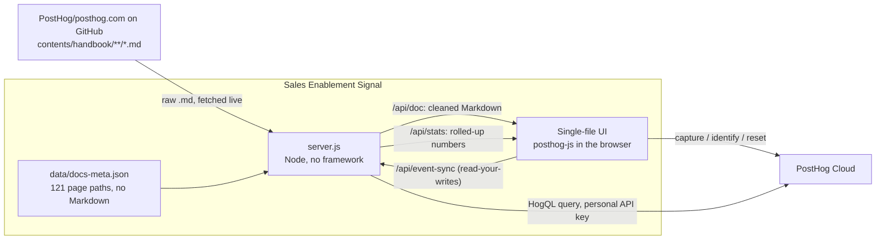

# Architecture

How Sales Enablement Signal is implemented. Back to the [README](../README.md).

## How it's implemented

### Architecture



### A handbook with zero local copies

The repository contains no handbook Markdown. [`data/docs-meta.json`](../data/docs-meta.json) is a small index of 121 entries (`id`, `title`, `category`, repo `path`, handbook `url`) and nothing else.

When a rep opens a page:

1. The browser calls `GET /api/doc?id=...`.
2. The server fetches `https://raw.githubusercontent.com/PostHog/posthog.com/master/<path>` and caches the result in memory for 10 minutes (`?refresh=1` bypasses the cache).
3. It cleans the source so it renders as plain Markdown: strips the YAML front matter, turns `<PrivateLink>` into a normal link, resolves `<SmallTeam>` and `<TeamMember>` tags to names, drops `<CalloutBox>` wrappers and turns images into links.
4. The browser renders it with [`marked`](https://github.com/markedjs/marked), splits it into sections on the headings (which also builds the section chips), and shows the fetch state in the source line. If `/api/doc` fails, the browser falls back to fetching the same GitHub URL directly. If that fails too, the page shows an error with links to the canonical page and the source file.

Because content always comes from `master`, an edit merged into the PostHog handbook shows up here as soon as the cache expires.

### Client instrumentation

`posthog-js` is served from the installed npm package at `/vendor/posthog.js`, and the app reads its project token and host from `GET /api/config`. It initialises with `autocapture`, `capture_pageview` and `capture_pageleave` switched off, because the app decides what counts as a view and a leave itself. Persistence is `memory`, so a reload starts a fresh anonymous session before the rep is identified again.

A small `cap()` wrapper sends every call to PostHog and also mirrors it into the Event stream drawer, so what you see there is what was sent.

The engagement logic is deliberately simple. A one-second interval adds to the visit's dwell counter only while the tab is visible and the Read view is open. At 30 seconds it fires `enablement_engaged_read`. When the visit ends, `enablement_page_left` reports the dwell and whether the visit was engaged.

### Server-side analytics with HogQL

`GET /api/stats` runs two queries against PostHog Cloud with a **personal API key that never leaves the server**:

```sql
-- usage: one row per page and rep
SELECT
  properties.doc_path AS doc_path,
  distinct_id,
  countIf(event = '$pageview')                 AS views,
  countIf(event = 'enablement_engaged_read')   AS engaged,
  sumIf(toFloatOrZero(toString(properties.dwell_seconds)),
        event = 'enablement_page_left')        AS dwell,
  dateDiff('day', maxIf(timestamp, event = '$pageview'), now()) AS last_days
FROM events
WHERE timestamp >= now() - INTERVAL 30 DAY
  AND event IN ('$pageview', 'enablement_engaged_read', 'enablement_page_left')
  AND properties.doc_path IS NOT NULL
GROUP BY doc_path, distinct_id
```

A second query pulls `survey sent` events (`$survey_response`, `$survey_response_1`, timestamp) for the survey results and the "what was missing" notes. The server maps rows back to pages and reps and returns one JSON object, which drives the rail in the Read view and every table in the Team view.

Keeping the personal key on the server means the UI can show PostHog data to anyone who can open the app, with no PostHog login and no read credentials in the browser.

### Read-your-writes

PostHog ingestion is fast but not instant, and a demo where your own click doesn't show up feels broken. So the browser also posts each page event to `POST /api/event-sync`, and the local server keeps a short list in `data/live-events.json` (git-ignored). When `/api/stats` builds its response it overlays any live event that has not appeared in the HogQL results yet. Events are matched on `ph_sync_id`, so nothing is ever counted twice once PostHog has caught up.

The same handler (`lib/api.js`) also runs as a Netlify Function behind <https://posthog-handbook-signal.netlify.app>. Serverless functions have an ephemeral filesystem, so there is no event store: `/api/event-sync` validates and acknowledges (`persisted: false`), `/api/stats` is pure live HogQL, and read-your-writes comes from the page updating its own state optimistically while `posthog-js` ingests the event in PostHog. Every `/api/*` response carries CORS headers (and `OPTIONS` is answered), so a static origin such as GitHub Pages queries the same live API.

`/api/event-sync` is public, so it validates before storing anything: the body is capped at 8 KB, the event name must be one of `$pageview`, `enablement_engaged_read`, `enablement_page_left`, `enablement_section_viewed` or `survey sent`, `distinct_id` and `doc_path` must match a known rep and page, `$survey_response` must be exactly `Yes`, `Partly` or `No`, strings are length-bounded (notes 500 characters, others 200), and only whitelisted properties are kept. On the client, `renderSurvey` HTML-escapes the stored answer before it reaches `innerHTML` (`npm test` guards this).

### Seeding a fresh project

An empty analytics project makes a dull demo. `seed-posthog.js` fixes that:

- It creates the `enablement-helpful` survey if it is missing and stamps every seeded `survey sent` event with that survey's UUID as `$survey_id`.
- It generates a deterministic 30-day history for the five fictional reps (from [`seed-generator.js`](../seed-generator.js)) and sends it to `/batch/`. That is **4,120 events**: 5 `$identify`, 1,278 `$pageview`, 734 `enablement_engaged_read`, 1,278 `enablement_page_left` and 825 `survey sent`.
- Event UUIDs are derived from content, and every event carries `seeded: true`.
- Before it writes anything it checks the project with HogQL and refuses to run on top of a partly seeded or already contaminated project unless you pass `--force`. A project that already has the full set is left alone.
